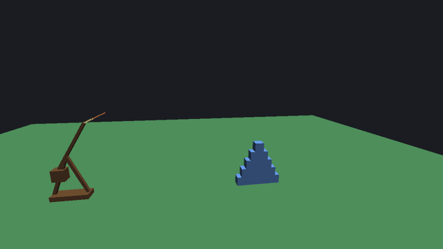
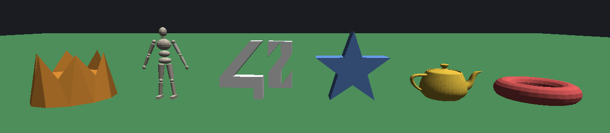
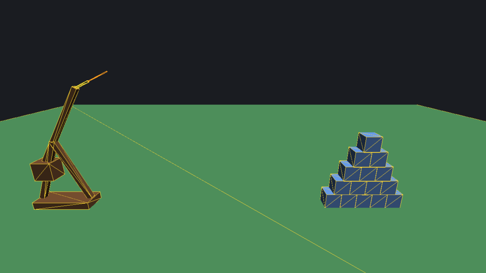
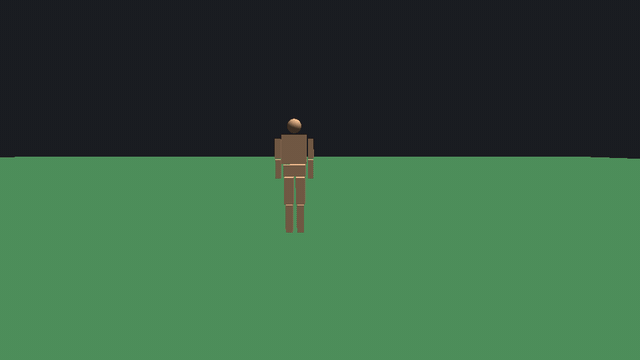
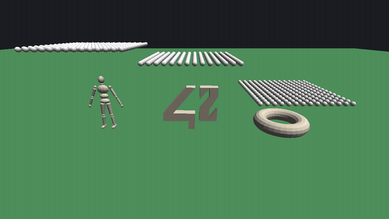
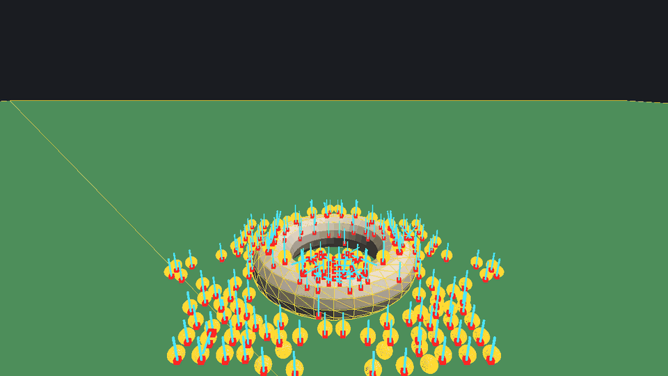
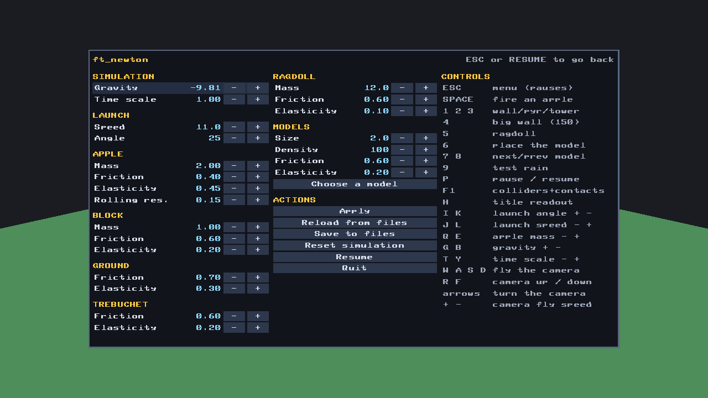
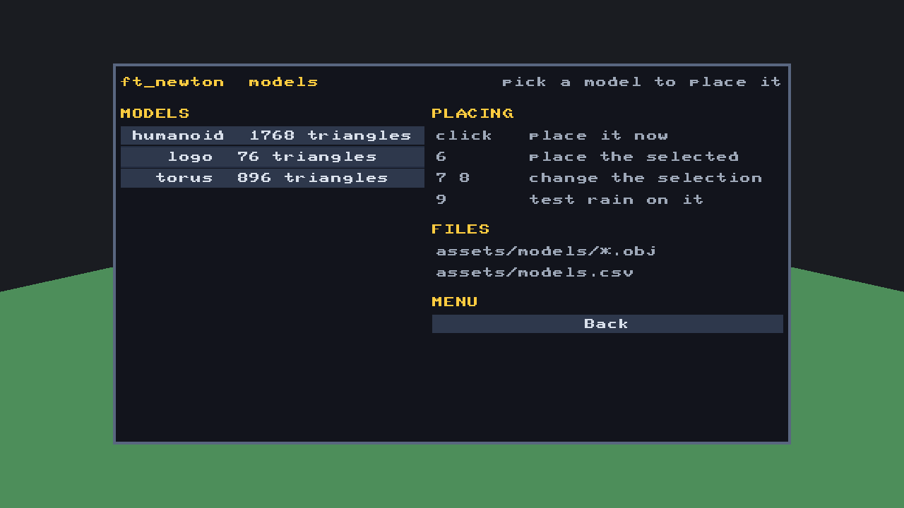

# ft_newton

## 📖 About

ft_newton is a **3D rigid-body physics engine** written from scratch in C, in
the spirit of PhysX, Havok or Bullet, shown through an Angry-Birds-style game: a
trebuchet throws apples at unstable structures of blocks, and every reaction
(translation, rotation, bounces, friction, rolling, gravity) is computed by the
engine itself.

The scene is drawn with **OpenGL 3.3 Core** (GLFW for the window and the input,
GLAD to load the GL functions) through two hand-written shaders. All the
mathematics (vectors, matrices, quaternions, inertia tensors) and all the
physics (integration, collision detection, contact response, joints) are
implemented in the project: there is no physics, collision or maths library
anywhere, and the only libraries linked are GLFW, OpenGL, `libdl`, `pthread` and
`libm`.

The engine does not approximate: boxes collide through the separating axis
theorem and clipped face manifolds, contacts are solved with sequential
impulses, friction is Coulomb, spheres roll and resist rolling, positions are
corrected after the impulses, and a pile that has come to rest is put to sleep
as a whole island. Anything the engine refuses (a body starting inside another
one, a malformed object file) is reported instead of being patched up.

The gameplay happens on the XY plane, but nothing in the engine is 2D: the
integrator, the colliders and the camera are fully three-dimensional, and the
camera flies freely through the scene at any time. The simulation runs on a
fixed 120 Hz step whatever the display rate is, and the time scale changes how
many steps a frame runs, never their size.

The engine goes past the game with **joints** and **mesh colliders**. A ragdoll
of eleven bodies is held together by ten joints with human limits, and every
`.obj` model dropped in `assets/models/` collides through its own triangles,
with its mass, centre of mass and inertia tensor computed from the volume it
encloses. Models exported for display, with split vertices, holes or mixed
winding, are repaired on load. A humanoid, a logo and a torus ship with it, and
a rain of small balls shows exactly where their surfaces are.

<details>
<summary><strong>🖼️ Screenshots</strong></summary>

<br>

<p align="center">
  
</p>

<p align="center"><sub>An apple from the trebuchet hits the pyramid, a 6x6 wall (<code>1</code>) is dropped on top of it and partly topples, and a second apple flies into the pile.</sub></p>

<p align="center">
  
</p>

<p align="center"><sub>Every <code>.obj</code> of <code>assets/models/</code> becomes a dynamic body that collides through its own triangles: the three shipped models with scop's crown, star prism and Utah teapot (repaired on load: 403 split vertices welded, 6 holes closed).</sub></p>

<br>

</details>

## 🎯 Objectives

- Writing the maths from scratch: vectors, matrices, quaternions, inertia
  tensors, and the world-space form of a tensor that turns with its body
- Implementing **semi-implicit Euler** integration over a fixed step, with
  quaternion orientation integration and renormalisation
- Building **collision detection** in three stages: AABBs and sweep and prune,
  then the exact test of every shape pair, then contact generation
- Implementing the **separating axis theorem** on 15 axes, face clipping
  (Sutherland-Hodgman) and the reduction of a contact patch to four spread
  points
- Solving contacts with **sequential impulses**: effective mass, accumulated
  clamping, warm starting, Coulomb friction and rolling resistance
- Removing the leftover overlap with **positional correction**, on positions and
  not on velocities, so no energy is added
- Making a scene come to rest: island sleeping, a bounce threshold, friction,
  angular damping and culling of what left the world
- Writing **joints** as constraints: a ball and socket solved as one 3x3 system,
  swing and twist limits, hinges, and a ragdoll built from them
- Turning **any model into a collider**: an `.obj` reader with ear clipping, a
  repair pass that makes the surface closed and outward, mass properties by the
  divergence theorem, a bounding volume tree, and exact sphere, box, plane and
  mesh tests against triangles
- Placing new bodies without ever creating an overlap, and refusing the ones
  that would
- Loading the object definitions strictly: no silent defaults, every mistake
  reported with its file and line
- Rendering an interactive 3D scene, a free camera, a debug wireframe view and a
  two-page 2D menu drawn by the engine's own overlay
- Freeing everything on every path, and checking it with valgrind at every
  optimisation level

## 📋 Function Overview

<details>
<summary><strong>ft_newton — modules breakdown</strong></summary>

<br>

| Module | Feature | Description |
|--------|---------|-------------|
| **math** | Vectors | `vec3`: add, subtract, negate, scale, dot, cross, length, normalise, component-wise min and max |
| **math** | Matrices | `mat3` for inertia tensors and joints (product, sum, scale, transpose, inverse, cross-product matrix, from a quaternion); `mat4` for rendering (translation, scale, rotation, perspective, look-at) |
| **math** | Quaternions | Rotation of a vector, composition, shortest arc between two vectors, integration of an angular velocity, renormalisation |
| **physics** | Bodies | Mass, `inverseMass`, `inverseInertiaLocal`, forces, torque, impulses at a point, accumulators cleared every step |
| **physics** | Inertia | Solid sphere `I = (2/5) m R²` [F5], solid box from its half extents [F6], conjugated into world space [F7] |
| **physics** | Mesh inertia | Volume, centre of mass and full inertia tensor of a closed surface by the divergence theorem, moved to the centre of mass [F27] |
| **physics** | Integration | Semi-implicit Euler [F1]-[F2]: velocity first, then the position moves with the new velocity; angular damping [F4] |
| **physics** | World | The body array (add, swap-with-last removal, clear, wake all), the growing scratch arrays, and `world_step` |
| **physics** | Joint list | A joint made from the current pose of its bodies, renumbered when bodies are removed, and the jointed pairs that do not collide |
| **physics** | Sleeping | Union-find over the contacts and the joints: an island sleeps only when **all** its bodies stayed still for 0.5 s, shaking in place counting as still, or crept slowly for 3 s [F24] |
| **physics** | Culling | Bodies 200 m away, or 20 m under a plane after falling past its edge, leave the world and the counters |
| **collision** | Colliders | Sphere, oriented box, **mesh**, and a **bounded plane**: solid down to 2 m under its surface, but only over the square that is drawn |
| **collision** | Broad-phase | Sweep and prune: AABBs sorted by minimum X, neighbours tested on Y and Z, static/static, sleeping/sleeping and jointed ragdoll pairs skipped |
| **collision** | Dispatch | Each candidate pair goes to its test; the normal is always rewritten to point from the first body to the second |
| **collision** | Sphere tests | Sphere/sphere, sphere/plane and sphere/box, the last through the closest point clamped in the box's own frame [F12]-[F14] |
| **collision** | Box tests | Box/plane corner by corner; box/box through SAT [F15], then clipping [F16] or an edge contact |
| **collision** | SAT | 15 candidate axes (6 faces, 9 edge cross products), least overlap wins, with a bias that prefers face normals |
| **collision** | Manifolds | Sutherland-Hodgman clipping of the incident face, then the deepest point, the farthest one and the two widest kept |
| **collision** | Overlaps | Does a body sink into another one, which body occupies a spot: the questions asked when placing new bodies |
| **collision** | Mesh shapes | An `.obj` turned into a collider: scaled to its `size`, repaired, centred on its centre of mass, indexed |
| **collision** | Mesh repair | Split vertices welded, repeated faces dropped, each piece oriented from one face outward (the majority winding kept), holes closed by centroid fans, inward pieces turned; what cannot be closed is refused |
| **collision** | Mesh topology | Every edge paired with its opposite: neighbours of each triangle, face normals and angle-weighted vertex normals |
| **collision** | BVH | A balanced tree of triangle boxes (median split), walked with an explicit stack [F28] |
| **collision** | Closest points | On a triangle, with the corner, edge or face it lies on [F29]; between two segments |
| **collision** | Mesh queries | The surface point closest to a point, and whether that point is inside, through the pseudo-normal of the feature [F30] |
| **collision** | Mesh tests | Sphere against every nearby triangle, mesh against plane by vertices, mesh against mesh by the vertices inside the other [F30] and the edges crossing its surface [F37] |
| **collision** | Box against mesh | 13 axes per triangle, the triangle normal one-sided [F31], then clipping or an edge contact |
| **response** | Solver | Wake, prepare, warm start, 16 Gauss-Seidel passes (joints, then contacts), position correction, remember for the next step |
| **response** | Impulses | Normal impulse with accumulated clamping and elasticity [F20]-[F21], Coulomb friction on two tangents [F22], equal and opposite at the contact point [F9] |
| **response** | Rolling | Rolling resistance for spheres: an opposing spin impulse bounded by `c_rr R jn`, about both tangents and the normal [F26] |
| **response** | Correction | The overlap left beyond 5 mm removed in 3 passes, by moving **and** turning the bodies through the same effective masses [F23]; the joint drift closed in the same passes [F35] |
| **response** | Joint point | The shared point of a joint: a 3x3 effective mass, an accumulated impulse kept between steps [F32] |
| **response** | Joint limits | Swing, twist and hinge angle [F33]; locks and limits as clamped angular rows, acting just before a limit is reached [F34]; joint friction [F36] |
| **response** | Projection | What a step still leaves beyond 1 cm at an anchor or 5° past a limit put back on the child body, with the velocity that would reopen it [F38] |
| **response** | Mass ratio | A light body holding up one more than 10 times heavier counts as only 10 times lighter, and at most 10 times its own mass [F39] |
| **render** | Window | GLFW window and OpenGL 3.3 Core context, GLAD loader, framebuffer resize, cursor, mouse and keyboard queries |
| **render** | Shaders | Compiling and linking `shaders/basic.vert` / `basic.frag`, uniforms for the MVP matrices, the colour and the shading mode |
| **render** | Meshes | One unit cube, one sphere and one plane in GPU memory, scaled by each body's model matrix, and one mesh per model built from the triangles of its collider |
| **render** | Camera | Free-flying eye (position, yaw, pitch) with a 60° perspective, a clamped pitch and a fly speed of 2 to 60 m/s |
| **render** | Draw | Depth-tested draw calls, a flat mode for the debug wireframes and the aim bar, and the body-to-mesh mapping |
| **render** | Debug view | `F1` draws every collider as a wireframe, slightly inflated (the plane lifted) so it sits on the solid, and every contact point with its normal over everything |
| **render** | Overlay | A batched 2D layer: one vertex buffer with a colour per vertex, and the whole menu in a single draw call |
| **render** | Font | An 8×8 bitmap font for ASCII 32 to 126, with a fixed advance per glyph |
| **menu** | Rows | Sections, value rows (pointing into the draft), action buttons, model buttons and hint lines, with a value stepper per row |
| **menu** | Layout | The 75% panel, the columns in use and the rectangle of every row, recomputed each frame so the text scales with the window |
| **menu** | Input | Mouse hover, click and hold-to-repeat on `[-]` / `[+]`; arrows to move and change, ENTER to press a button |
| **menu** | Drawing | The panel, the title line of the page and every row, with the hovered and held states, drawn into the overlay |
| **data** | CSV reader | Header, then `property,value1,value2,value3` rows; plain decimal numbers only, trailing empty fields optional, blank lines tolerated |
| **data** | Getters | Typed access that counts errors instead of defaulting, an unknown-property check, and range checks that name the expected bound |
| **data** | Object definitions | Apples, blocks, ground and models loaded into definitions, the primitive bodies built from them, saved back to the same files |
| **data** | Trebuchet file | The machine's own file, with the projectile mass taken from the apple file and checked against its minimum |
| **data** | Ragdoll file | Height, mass and material of the ragdoll, checked against their ranges |
| **data** | OBJ reader | Two passes (vertices, then faces), `v` / `v/vt` / `v//vn` / `v/vt/vn` corners, negative indices, ear clipping in the plane of the Newell normal, `file:line` errors |
| **game** | Loop | Poll, read the input, drain the accumulated time in fixed steps, update the counters, draw, swap, sleep to the frame cap |
| **game** | Input | Every key of the game (fire, spawn, model selection, pause, toggles, live tuning, camera), with held keys changing a value per second |
| **game** | HUD | FPS, object counter, live values and the selected model in the window title, rewritten five times a second |
| **game** | Scene | Loading the object files, building the starting scene and rebuilding it on reset, re-stamping mass and material |
| **game** | Scene check | The starting scene built aside before the window opens: trebuchet and pyramid over the ground and not sunk into it, no overlap, a free apple spawn point, a camera above the ground and outside every body |
| **game** | Model library | Every `.obj` of `assets/models/` found at start-up, loaded in name order (up to 16), failures reported and skipped, and the selected model |
| **game** | Models | A model body: its shared surface, a mass of density times volume, the shared material; every model rescaled at once when the size changes |
| **game** | Placement | New bodies lifted as one group onto whatever occupies their spot, then added |
| **game** | Camera collision | The camera as a 0.3 m sphere: moved in 10 cm steps, pushed out of every body after each step and each frame, out of a model that swallows it through the closest surface point, to the nearest free spot when pinned |
| **game** | Ragdoll | Eleven parts from a table of proportions, ten joints with human limits |
| **game** | Test rain | 196 small balls a metre above whatever stands at the spot, landing on its real surface |
| **game** | Structures | Walls, pyramids and towers spawned on demand |
| **game** | Trebuchet | Five static boxes built from the file; the launch point at the tip of the arm, the shot, and the refusal when the point is blocked |
| **game** | Clearance | A ray along the firing line against every box grown by the apple's radius, at every allowed angle, gives one spawn distance |
| **game** | Projectile | An apple with its launch velocity from the file's speed and angle, and the mass of the next apples |
| **game** | Menu pages | The main page (values, actions, controls) and the models page (one button per model, placing help, the files, Back) |
| **game** | Actions | What the menu buttons do: sync the draft, apply, reload, save, reset, resume, quit, open the models page, place a model |
| **utils** | Arguments | The optional `[width height]`, accepted only when both are numbers inside the window bounds |
| **utils** | Files and arrays | A whole file in memory (shaders, models), and arrays that grow by doubling |

<br>

</details>

<details>
<summary><strong>Usage Example & Testing</strong></summary>

<br>

### Build and run

```bash
make install                # checks the compiler, pkg-config, GLFW and OpenGL
make                        # builds ./newton (and the vendored GLAD) with -O3
make O=0                    # ... or with -O0, -O1, -O2, -Os or -Og: the objects rebuild when the flags change
make run                    # builds and runs with the default 1280x720
make run ARGS="1920 1080"   # ... or at another size
make valgrind               # builds and runs under valgrind with the suppression files
make clean && make re       # object files, then a full rebuild
make fclean                 # removes objects/ and the binary
```

The program runs **from the repository root**: `shaders/` and `assets/` are
opened by relative path.

```bash
./newton             # window of 1280x720
./newton 2560 1440   # the largest accepted size
./newton 100 100     # out of range: warns and falls back to 1280x720
./newton 800         # wrong argument count: prints the usage and exits 1
```

### What the window shows

The starting scene is a 160 m square of ground, the five boxes of the trebuchet
at x = -12 and a five-row pyramid of blocks at x = 8. The camera starts on the
+Z side, framing the machine on the left and the pyramid on the right.

The title is rewritten every 0.2 s from the live state (`H` hides it), in the
shape below; the values are the ones a fresh run reports:

```
ft_newton  |  FPS: nn  |  objects: 21  |  g: -9.81  |  time: x1.00  |  speed: 11.0 m/s  |  angle: 25 deg  |  mass: 2.00 kg  |  model: humanoid
```

`SPACE` fires an apple whose parabola is not scripted: the apple is an ordinary
rigid body from its first step. A wall spawned with `1` and hit by it tips,
slides, piles up and finally switches off as one sleeping island. `F1` shows the
colliders that produce all of it, `T` slows the time down to follow a single
impact step by step, and `P` freezes a contact to look at it from any angle.

`5` stands a ragdoll at x = 2 m, under the default shot: with nothing to hold it
up it folds at the knees, hips and waist and lies down. The default shot flies
over it; a lower one (`K`) knocks it over. `6` places the selected model at the
same spot, `7` and `8` change the selection, and `9` drops the test rain on
whatever stands there.

<p align="center">
  
</p>

<p align="center"><sub>The debug display (<code>F1</code>): every collider drawn as a yellow wireframe over the scene, slightly inflated (the ground plane slightly lifted), so the lines show the shape the collision code tests, not the mesh.</sub></p>

### Controls

The keys act on the running simulation immediately; the mouse and the keyboard
both drive the menu when it is open.

| Key | Action |
|---|---|
| `ESC` | open / close the menu (opening it pauses the simulation); on the models page, back to the main page |
| `SPACE` | fire an apple (refused, with a message, while the spawn point is blocked) |
| `1` / `2` / `3` | spawn a 6x6 wall / a 7-row pyramid / an 8-block tower at x = 8 m |
| `4` | spawn a 15x10 wall (150 blocks) at x = 20 m |
| `5` | spawn a ragdoll at x = 2 m |
| `6` | place the selected model at x = 2 m (mesh collider) |
| `7` / `8` | select the next / previous model (its name is in the window title) |
| `9` | drop the test rain (196 small balls) on whatever stands at x = 2 m |
| `P` | pause / resume |
| `F1` | collider wireframes and contact points on / off |
| `H` | window title readout on / off |
| `I` / `K` | launch angle up / down (-70 to 90 degrees) |
| `J` / `L` | launch speed down / up (1 to 60 m/s) |
| `Q` / `E` | mass of the next apples down / up (0.1 to 50 kg) |
| `G` / `B` | gravity up / down (-40 to 20 m/s²) |
| `0` | gravity off, then back to its previous value |
| `T` / `Y` | time scale down / up (0 to 4) |
| `W` `A` `S` `D` | fly the camera forward, left, backward, right |
| `R` / `F` | camera up / down |
| arrow keys | turn the camera |
| `+` / `-` | camera fly speed up / down (2 to 60 m/s) |

Held keys change a value at a fixed rate per second (10 m/s of launch speed, 60°
of angle, 1 kg of mass, 5 m/s² of gravity, 1 of time scale); the tuned values
are the ones the title shows. Changing gravity wakes every body, so a resting
pile reacts again instead of standing on stale supports.

The camera is a 0.3 m sphere that collides with the scene: it slides along the
bodies it flies into, stops at a gap narrower than itself, and is pushed out by
any body that moves, falls or appears where it stands. It moves in steps of 10
cm at most, a third of its radius, so not even a thin arm can be crossed at the
top fly speed.

The yellow bar at the tip of the throwing arm shows the launch direction, and
the thin line past it grows with the launch speed (0.12 m per m/s). A new apple
appears past that bar, at the same distance for every allowed angle: the
distance is computed once, by testing the firing line against the machine's
boxes grown by the apple's radius.

Structures always appear at the same spot, and so do the ragdoll, the models and
the rain at theirs. When that spot is taken, the whole group is lifted until no
body would sink into what is there, and it lands on top of it, so no body ever
starts inside another one. The test uses the real surfaces: a torus placed where
the humanoid stands appears on the ground around its feet, because its hole is
wider than the humanoid's stance and nothing overlaps.

### Test scenes

The launch values are set with `I` `K` (angle) and `J` `L` (speed), or in the
menu. At x = 2 m (ragdoll, models, test rain), an apple hits at -10° and 11 m/s,
-25° and 20 m/s, or -30° and 40 to 60 m/s; the default shot (25°, 11 m/s) hits
the starting pyramid.

| Scene | Keys and values | Result |
|---|---|---|
| Throw | `SPACE` | The apple follows a parabola and knocks the pyramid at x = 8 m; every block comes back to rest and sleeps |
| Gravity | `0`, then `SPACE`; `G` `B` | Without gravity the apple flies in a straight line and nothing falls; `0` again restores the previous value (-9.81 m/s² at start); any value from -40 to 20 m/s² applies at once and wakes every body |
| Slow motion | `T` down to 0.1, `P` | Time runs ten times slower, the step stays 1/120 s; pause freezes it |
| Masses | `E` up to 50 kg, then `Q` down to 0.1 kg, with the default shot | The 50 kg apple scatters the starting pyramid (blocks thrown up to 13 m); the 0.1 kg apple bounces back at about 3 m/s and moves no block |
| Fast projectile | 60 m/s at -30° against the ragdoll or a model, at -15° against the starting pyramid | No tunnelling: the apple never passes through what it hits; its radius is at least 0.25 m, so even at 60 m/s it moves no more than its diameter per step; every other body (a rain ball thrown by a 50 kg apple) has its speed clamped to its own thinnest dimension per step |
| Many objects | `4` several times, `9` | 150 blocks per wall, 196 balls per rain, the frame rate and the object count in the title; measured on a desktop processor, about 900 bodies keep the average step under the 8.3 ms of real time |
| Wireframes | `F1` | Every collider in yellow and every contact in red with its normal in cyan |
| Ragdoll | `5`, then `SPACE` at -10° and 11 m/s | The ragdoll folds at the joints within their limits, never comes apart, and sleeps as one island |
| Mesh colliders | `7` `8` to choose, `6` to place, `9` for the rain, `F1` | The balls rest on the exact surface: between the humanoid's legs, through the hole of the torus, in the openings of the logo |
| Camera | `W` `A` `S` `D` `R` `F` into any body | The camera stops at the surface or slides along it; a body dropped on it pushes it out |
| Starting scene | `assets/trebuchet.csv` with `position,0,6,33.7` | `assets/trebuchet.csv: the camera would start inside the trebuchet at (0, 8.75, 33.7)` and exit status 1 |
| Object file | `assets/block.csv` with `mass,-1,,` | `assets/block.csv:4: 'mass' must be within [0.1, 50]` and exit status 1 |
| Reload | the same edits, then **Reload from files** in the menu | The same messages, then `Reload aborted: the object files above need fixing`; the running scene is kept |

### Error handling

The engine reports what it will not do instead of quietly fixing it. All of
these are real messages from the program:

```bash
$ ./newton 800
Usage: ./newton [width height]
$ ./newton 100 100
Width '100' is out of range [720..2560]; using default 1280
Height '100' is out of range [480..1440]; using default 720
$ mv assets/apples.csv /tmp/ && ./newton
assets/apples.csv: cannot open this object file (No such file or directory)
every assets/*.csv file is required and must be valid
```

A broken object file stops the load with its line and the reason, and nothing is
half-loaded:

```
assets/block.csv:1: first line must be the header '# property,value1,value2,value3'
assets/block.csv:4: 'mass' must be within [0.1, 50]
assets/block.csv:9: unknown property 'density'
assets/ground.csv: missing property 'normal'
assets/apples.csv:7: duplicated property 'mass'
assets/apples.csv:2: unknown shape 'disc' (expected sphere, box, plane or mesh)
assets/ragdoll.csv:2: 'height' must be within [0.5, 3]
assets/models.csv:4: 'density' must be within [10, 1000]
```

A model file never stops the program. What can be repaired is repaired and
reported on standard output; what cannot is reported on standard error and the
model is skipped:

```
assets/models/teapot.obj: repaired (403 vertices welded, 0 faces dropped, 0 faces turned, 6 holes closed, 0 pieces turned outward)
assets/models/torus.obj: repaired (0 vertices welded, 0 faces dropped, 1 faces turned, 0 holes closed, 0 pieces turned outward)
assets/models/logo.obj:93: vertex index out of range '999'
assets/models/logo.obj: model skipped
assets/models/fin.obj: 1 edges are shared by more than two faces
assets/models/strip.obj: the surface cannot be oriented (its two sides meet)
assets/models/: only the first 16 models are loaded, 4 files ignored
```

The starting scene is built aside before the window opens, and every problem in
it is reported with the files involved and the position: a trebuchet or a
pyramid that would sink into the ground, overlap each other or stand off the
ground square, an apple spawn point taken by another body, and a camera that
would start under the ground or inside a body. The program then exits with
status 1, and **Reload from files** refuses the same files and keeps the running
scene:

```bash
$ sed -i 's/^position,.*/position,0,6,33.7/' assets/trebuchet.csv && ./newton
assets/trebuchet.csv: the camera would start inside the trebuchet at (0, 8.75, 33.7)
$ git checkout assets/trebuchet.csv
$ sed -i 's/^offset,.*/offset,9,,/' assets/ground.csv && ./newton
assets/trebuchet.csv, assets/ground.csv: the trebuchet would sink into the ground at (-12, 0, 0)
assets/block.csv, assets/trebuchet.csv, assets/ground.csv: the starting pyramid would overlap the trebuchet or sink into the ground at (8, 0, 0)
assets/trebuchet.csv, assets/apples.csv: the apple spawn point of the trebuchet is taken by another body at (-9.07481, 8.24377, 0)
assets/ground.csv: the camera would start under the ground at (0, 8.75, 33.7)
```

At runtime, `SPACE` prints
`Launch point blocked: an apple would start inside another body` when something
already occupies the spawn point.

### Valgrind

```bash
# The engine's own allocations: what the window, toolkit and GL driver keep
# until exit is suppressed, so what is left is the program's.
make valgrind                                                              # any valgrind version

# by hand, any version
valgrind --leak-check=full --show-leak-kinds=all --track-origins=yes \
         --keep-debuginfo=yes --suppressions=docs/valgrind.supp ./newton
# by hand, valgrind 3.22 or newer
valgrind --leak-check=full --show-leak-kinds=all --track-origins=yes \
         --keep-debuginfo=yes --suppressions=docs/valgrind.supp \
         --suppressions=docs/valgrind_recent.supp ./newton
```

Two suppression files cover everything outside the project:

| File | Valgrind | What it silences |
|---|---|---|
| `docs/valgrind.supp` | every version | Leaks from GLFW, X11 / xcb, Wayland, GTK / GDK / libdecor, GLib / GIO, D-Bus, fontconfig, pango, cairo, glycin, the GL driver (NVIDIA, Mesa, LLVM, EGL, GLX), libstdc++ and glibc's `dlopen`; the invalid reads in GIO's and GTK's start-up and in the loader's `strncmp` |
| `docs/valgrind_recent.supp` | 3.22 or newer | The NVIDIA EGL driver's zero-size `realloc` / `posix_memalign` at start-up (`ReallocZero`, `BadSize`) |

None of these is project code. Every suppression matches on the library the
allocation or the access happens in, never on a function of `srcs/`, so a leak
of the engine is still reported. They are blocks that system libraries allocate
once and keep for the life of the process: the display connection, the GTK
toolkit that libdecor starts for window decorations on Wayland and the D-Bus
connection it opens to the desktop portal, fontconfig's font cache, the shader
compiler and the LLVM JIT of the Mesa driver, the buffers glibc keeps for every
library loaded with `dlopen`, and two `wl_proxy` objects that GLFW creates on
Wayland and does not destroy in `glfwDestroyWindow` (a known GLFW bug). The
program releases everything it owns in `game_shutdown`, including
`glfwDestroyWindow` and `glfwTerminate`.

The second file exists because valgrind refuses a whole suppression file that
names an error kind it does not know, and `ReallocZero` / `BadSize` only exist
since 3.21 / 3.22. `make valgrind` always loads the first file and adds the
second only when the installed valgrind accepts it.

`--keep-debuginfo=yes` is required: the Mesa driver is unloaded before the leak
check, and without the flag its frames lose their library name and no
suppression matches them. The cleanup runs when the program closes through the
menu or the window's close button; `Ctrl+C` skips it. A clean run reports
`definitely`, `indirectly`, `possibly lost` and `still reachable` at 0 bytes and
`ERROR SUMMARY: 0 errors`, with everything else counted as `suppressed`; `-s`
lists every suppression used.

The program is its own test bench: `F1` shows the colliders and the contacts,
`T` slows the time, `P` freezes it, and `9` rains balls on a model. The project
sources are built with `-Wall -Wextra -Werror` at every optimisation level
(`make O=0` to `make O=3`, with gcc and clang), so a warning is a build failure;
only the vendored GLAD is compiled with the relaxed flag set.

<br>

</details>

## 🚀 Installation & Structure

<details>
<summary><strong>📥 Setup & Usage</strong></summary>

<br>

### Host requirements

| Tool | Needed for | Notes |
|------|------------|-------|
| `cc` (gcc or clang) | Compiling | `-Wall -Wextra -Werror -g3 -O3` |
| `make` | Driving the build | One `make` builds the sources and the vendored GLAD |
| **GLFW 3** | Window and input | Development headers, `-lglfw` |
| **OpenGL** | Rendering | A 3.3 Core capable driver (Mesa or a vendor one), `-lGL` |
| Any Linux / Unix | Running | Also links `-ldl -lpthread -lm` |

GLAD is **not** an external dependency: the generated loader for OpenGL 3.3 Core
(no extensions) is committed in `glad/` and compiled with the project.

```bash
# Arch
sudo pacman -S --needed glfw mesa
# Debian / Ubuntu
sudo apt install libglfw3-dev libgl1-mesa-dev
```

### Make targets

```bash
make install    # check the compiler, pkg-config, GLFW and OpenGL
make            # build ./newton (project sources, then glad/src/gl.c) with -O3
make O=0        # optimisation level: 0, 1, 2, 3, s or g; the objects rebuild when the flags change
make run        # build and run; ARGS="1280 720" is passed to the binary
make valgrind   # build and run under valgrind with docs/*.supp; takes ARGS too
make clean      # remove the objects/ directory
make fclean     # clean + remove the binary
make re         # fclean + build
make help       # this list
```

Project sources are compiled with the strict warning set; the vendored GLAD is
compiled with the same optimisation but without `-Wall -Wextra -Werror`, so a
warning from generated code cannot stop the build. Dependencies are tracked
(`-MMD -MP`), so touching a header rebuilds what includes it, and
`objects/.flags` holds the compile flags: a different `O` (or `CC`) rebuilds
everything, the same one rebuilds nothing.

### Running

```bash
./newton                    # 1280x720
./newton 1920 1080          # any size in [720..2560] x [480..1440]
make run ARGS="2560 1440"
```

| Argument | Default | Accepted |
|---|---|---|
| `width height` | `1280 720` | Both decimal, from 720x480 to 2560x1440 |

The program takes either no argument or exactly two: a width and a height, both
decimal, inside the bounds above. Anything else prints the usage and exits with
status 1; a single bad value is replaced by the default and reported on stderr.

### Object file format

Each object is one small CSV file in `assets/`, named by its first row:

```
# property,value1,value2,value3
shape,sphere,,
radius,0.5,,
mass,2,,
rolling_resistance,0.15,,
friction,0.4,,
elasticity,0.45,,
color,0.85,0.25,0.25
```

| File | Property rows |
|---|---|
| `assets/apples.csv` | `shape` (sphere), `radius` (0.25 m or more), `mass`, `rolling_resistance`, `friction`, `elasticity`, `color` |
| `assets/block.csv` | `shape` (box), `size`, `mass`, `friction`, `elasticity`, `color` |
| `assets/ground.csv` | `shape` (plane), `normal`, `offset`, `extent`, `friction`, `elasticity`, `color` |
| `assets/trebuchet.csv` | `position`, `base_size`, `frame_height`, `arm_length`, `arm_thickness`, `arm_angle`, `counterweight_size`, `launch_speed`, `launch_angle`, `friction`, `elasticity`, `color` |
| `assets/ragdoll.csv` | `height`, `mass`, `friction`, `elasticity`, `color` |
| `assets/models.csv` | `shape` (mesh), `size` (the longest side of every model's box, 0.2 to 6 m), `density` (10 to 1 000 kg/m³), `friction`, `elasticity`, `color`, shared by every model |

The format is deliberately small and strict: `#` comments and the header line,
then one property per line holding one number, three numbers, or one word.
Numbers are plain decimals (no `nan`, `inf` or hex), trailing empty fields may
be left out, blank lines and CRLF are tolerated, and **nothing has a fallback
value**: a misspelt property, a missing one, a wrong number of fields, a
duplicate row or a value outside its range stops the load with
`file:line: reason`. The ground file must describe a plane, the apple file a
sphere, the block file a box and the models file a mesh.

Every file ending in `.obj` in `assets/models/` is a model, loaded at start-up
in name order, up to 16; its name without the extension is the one the menu and
the title show. A model's `.obj` may use any polygon (concave ones are
ear-clipped), `v`, `v/vt`, `v//vn` or `v/vt/vn` corners and negative indices;
everything but `v` and `f` is skipped. The collider needs an inside, so the
surface is repaired into a closed one wound outward; its volume then gives the
mass (with the shared density), the centre of mass and the inertia tensor. A
model is loaded once and shared by every body placed from it.

`Save to files` in the menu writes the draft back in exactly this format, in a
fixed property order, so the files stay diff-friendly.

<br>

</details>

<details>
<summary><strong>📁 Project Structure</strong></summary>

<br>

```
ft_newton/
│
├── README.md                       # Main project documentation
├── Makefile                        # Build rules: ./newton (O=0..3, s, g), install, run, valgrind, clean, fclean, re, help
├── .gitignore                      # objects/, the binary, editor files
│
├── includes/
│   ├── newton.h                    # Every type, then every prototype, grouped by source folder
│   └── defines.h                   # Every constant, grouped and commented with its unit
│
├── docs/
│   ├── README.md                   # Condensed project documentation
│   ├── valgrind.supp               # Suppressions for everything outside the project, any valgrind
│   ├── valgrind_recent.supp        # NVIDIA start-up errors only valgrind 3.22+ knows
│   ├── info/
│   │   ├── architecture.md         # Files, the main loop, one physics step
│   │   ├── physics.md              # Every formula, tagged [F1] to [F39]
│   │   ├── collisions.md           # Broad-phase, narrow-phase, mesh colliders, response, classic problems
│   │   ├── rendering.md            # Window, meshes, camera, draw calls, overlay
│   │   ├── shaders.md              # The two shaders, line by line
│   │   └── object-files.md         # The CSV format, the .obj models, their repair and their checks
│   └── img/
│       ├── newton.gif              # An apple, a wall and a second apple, recorded from the window
│       ├── colliders.png           # F1 debug display, collider wireframes
│       ├── models.png              # Six models standing side by side
│       ├── ragdoll.gif             # An apple into a standing ragdoll
│       ├── rain.gif                # The test rain on the humanoid, the logo and the torus
│       ├── mesh.png                # F1 on the torus: its triangles, the contacts and their normals
│       ├── menu.png                # The menu, main page
│       └── menu_models.png         # The menu, models page
│
├── assets/                         # The object definitions (CSV) and the models
│   ├── apples.csv                  # Sphere: radius, mass, rolling resistance, material, colour
│   ├── block.csv                   # Box: size, mass, material, colour
│   ├── ground.csv                  # Plane: normal, offset, extent, material, colour
│   ├── trebuchet.csv               # Position, base, frame, arm, counterweight, launch settings
│   ├── ragdoll.csv                 # Height, mass, material, colour
│   ├── models.csv                  # Size, density, material and colour of every model
│   └── models/
│       ├── humanoid.obj            # A mannequin, one closed shell per segment (1 768 triangles)
│       ├── logo.obj                # The logo model scop displays, facing +Z (76 triangles once ear-clipped)
│       └── torus.obj               # A ring, major radius 1, tube radius 0.32 (896 triangles)
│
├── shaders/
│   ├── basic.vert                  # GLSL 3.30 core: the MVP chain, the world normal
│   └── basic.frag                  # Three modes: lit, flat, and one colour per vertex
│
├── glad/                           # OpenGL 3.3 Core loader, generated, committed
│   ├── include/glad/gl.h           # The GL function pointers
│   ├── include/KHR/khrplatform.h   # The types those pointers use
│   └── src/gl.c                    # The loader implementation
│
└── srcs/
    ├── main.c                      # game_init -> game_run -> game_shutdown
    │
    ├── math/
    │   ├── vec3.c                  # Vectors: add, dot, cross, length, normalise
    │   ├── scalar.c                # clampf, shared by collision, solver and menu
    │   ├── mat3.c                  # Inertia tensors: inverse, transpose, from a quaternion
    │   ├── mat4.c                  # Rendering matrices: transform, perspective, look-at
    │   └── quat.c                  # Quaternions: rotate, compose, shortest arc, integrate
    │
    ├── physics/
    │   ├── rigidbody.c             # Mass, forces, torque, impulses at a point
    │   ├── inertia.c               # Sphere, box and mesh tensors, and their world-space form
    │   ├── mesh_inertia.c          # Volume, centre of mass and inertia of a closed surface
    │   ├── integrator.c            # One semi-implicit Euler step, damping, orientation
    │   ├── world.c                 # The body array, the scratch arrays, world_step
    │   ├── joint_list.c            # The joint array: make, add, renumber, which pairs do not collide
    │   ├── sleep.c                 # Islands of contacts and joints, and the decision to sleep
    │   └── cull.c                  # Removal of bodies that flew away or fell off the edge
    │
    ├── collision/
    │   ├── collider.c              # The four shapes, the bounded plane, every AABB
    │   ├── broadphase.c            # Sweep and prune over the sorted AABBs
    │   ├── narrowphase.c           # Pair dispatch, normal orientation, contact collection
    │   ├── overlap.c               # Does a body sink into another one, which body occupies a spot
    │   ├── contact_sphere.c        # Sphere against sphere, plane and box
    │   ├── contact_box.c           # Box against plane, and box against box
    │   ├── contact_mesh.c          # Mesh against sphere, plane and mesh
    │   ├── contact_box_mesh.c      # Box against mesh: 13 axes per triangle
    │   ├── mesh_shape.c            # A model turned into a collider
    │   ├── mesh_repair.c           # Weld, drop repeats, orient, close holes, turn outward
    │   ├── mesh_topology.c         # Closed surfaces: neighbours, face and vertex normals
    │   ├── bvh.c                   # The bounding volume tree of a mesh
    │   ├── closest.c               # Closest points on a triangle and between segments
    │   ├── mesh_query.c            # Closest surface point, inside or outside
    │   ├── obb.c                   # Oriented-box helpers: axes, radius, corners, support edge, incident face
    │   ├── sat.c                   # The separating axis test on 15 axes
    │   └── manifold.c              # Face clipping, candidate sets and the reduction to four spread points
    │
    ├── response/
    │   ├── resolver.c              # Wake, prepare, warm start, iterate, correct, remember
    │   ├── impulse.c               # Normal, friction and rolling impulses of one contact
    │   ├── joint_point.c           # The shared point of a joint
    │   ├── joint_limit.c           # Swing, twist and hinge angle: locks and limits
    │   └── correction.c            # Removal of the overlap and the joint drift the impulses left
    │
    ├── render/
    │   ├── window.c                # GLFW window, OpenGL 3.3 Core context, input queries
    │   ├── shader.c                # Compiling, linking and the uniforms
    │   ├── mesh.c                  # The unit cube, sphere and plane, and each model, on the GPU
    │   ├── camera.c                # Free-flying eye, view and projection
    │   ├── renderer.c              # Per-frame setup, draw calls, body model and mesh
    │   ├── debugdraw.c             # The collider wireframes and the contacts (F1)
    │   ├── font.c                  # The 8x8 bitmap font for ASCII 32..126
    │   └── ui.c                    # The batched 2D overlay: rectangles and text
    │
    ├── menu/
    │   ├── menu.c                  # Rows, sections, buttons and stepping a value
    │   ├── menu_layout.c           # The 75% panel, the columns in use and the rectangle of every row
    │   ├── menu_input.c            # Hover, click, hold-to-repeat and the keyboard
    │   └── menu_draw.c             # Panel, title line and rows, into the overlay
    │
    ├── data/
    │   ├── csv_file.c              # The strict reader of the object files
    │   ├── csv_values.c            # Typed getters, unknown-property and range checks
    │   ├── object_def.c            # Definition <-> body, and saving the file back
    │   ├── trebuchet_file.c        # The trebuchet file: load, check, save
    │   ├── ragdoll_file.c          # The ragdoll file: load, check, save
    │   ├── obj_load.c              # The .obj reader: vertices, then faces
    │   ├── obj_face.c              # One face line resolved to vertex indices
    │   └── obj_triangulate.c       # Polygons to triangles by ear clipping
    │
    ├── game/
    │   ├── game.c                  # Start-up, the main loop, the frame cap, shut-down
    │   ├── draw.c                  # Bodies, aim bar, wireframes, menu and title
    │   ├── input.c                 # Every key the game reads
    │   ├── hud.c                   # FPS, counters, live values and the model in the title
    │   ├── scene.c                 # Loading the object files, the starting scene, re-stamping
    │   ├── scene_check.c           # The starting scene built aside and checked before the window opens
    │   ├── model_library.c         # Every .obj of assets/models/, loaded once, and the selected one
    │   ├── model.c                 # A model body: surface, density times volume, material
    │   ├── actions.c               # Apply, reload, save, reset, resume, quit, models page, place a model
    │   ├── menu_rows.c             # The two menu pages
    │   ├── placement.c             # New bodies lifted onto what is there, then added
    │   ├── camera_collision.c      # The camera as a sphere: pushed out of bodies, never flown through
    │   ├── structure.c             # Walls, pyramids and towers
    │   ├── ragdoll.c               # Eleven parts and ten joints
    │   ├── rain.c                  # The test rain
    │   ├── trebuchet.c             # The five boxes of the machine and the shot
    │   ├── trebuchet_clearance.c   # How far past the arm tip an apple must appear
    │   └── projectile.c            # An apple with its launch velocity and mass
    │
    └── utils/
        ├── arguments.c             # The optional [width height] arguments
        ├── array.c                 # Arrays that grow by doubling
        └── file.c                  # A whole file in memory
```

`includes/newton.h` holds every type, then every prototype grouped by source
folder in pipeline order (math, physics, collision, response, render, menu,
data, game, utils). Every constant lives in `includes/defines.h`, each group
titled and each value with its unit, so tuning values never hide inside a `.c`
file, and `srcs/main.c` is twelve lines long.

<br>

</details>

<details>
<summary><strong>🧱 Algorithm Overview</strong></summary>

<br>

### Pipeline

```
assets/*.csv ──────────> ObjectDef / Trebuchet / RagdollDef ──> RigidBody, Joint ──> World
assets/models/*.obj ──> ModelLibrary (MeshShape, loaded once, shared) ──┘              │
                                                                  world_step (1/120 s) │
                                                                                       v
                   input ──> frame loop ──> draw_frame (OpenGL) <── bodies, colliders, contacts
```

### One frame, one step

`game_run` repeats until the window closes or **Quit** is pressed:

1. poll the window events and measure the real frame time, capped at 0.25 s;
2. read the input: the menu while it is open, the game keys otherwise;
3. add `frame_time * time_scale` to an accumulator and drain it in fixed steps
   of 1/120 s, at most 32 per frame (a scene too heavy to keep up drops time
   instead of piling it up);
4. update the FPS average and draw the frame;
5. swap the buffers and sleep off what is left of the 1/30 s frame.

The time scale never changes the step size, only how many steps a frame runs. At
4x a fast apple is still checked every 1/120 s of simulated time; at 0.25x the
slow motion is exact.

### One physics step

```
integrate -> broad-phase -> narrow-phase -> response -> sleep -> cull
```

| Stage | What it does |
|---|---|
| **Integrate** | Every awake body: `a = F/m + g`, `v += a dt`, `x += v dt` with the **new** velocity, `alpha = I^-1 T`, `w += alpha dt`, damping, quaternion integration, world inertia refreshed |
| **Broad-phase** | AABBs sorted by minimum X; the neighbours that overlap on X are tested on Y and Z; a pair with no awake dynamic body is dropped, and so is a pair of ragdoll parts their joint keeps apart |
| **Narrow-phase** | The exact test of each candidate, up to four contacts per pair, every normal pointing from the first body to the second; a mesh through the triangles its tree hands over |
| **Response** | Wake what an awake body touches or is jointed to, prepare, warm start, 16 Gauss-Seidel passes (the joints: shared point, locks and limits; then each contact: rolling, friction, the normal impulse), 3 positional passes (joint drift, then overlap), remember |
| **Sleep** | Union-find over the contacts and the joints; an island whose bodies all stayed under 5 cm/s and 0.05 rad/s (or shook in place without moving) for 0.5 s, or crept at under four times that for 3 s, is switched off |
| **Cull** | Bodies 200 m from the origin, or 20 m under a plane, leave the world and the object counter |

### Collision detection in three questions

```
broad-phase        narrow-phase              response
"who might touch?" "where, how deep?"       "what impulses fix it?"
   AABBs, sweep       SAT, clipping,           sequential impulses,
   and prune          closest point            friction, correction
```

| Pair | Test |
|---|---|
| sphere / sphere | distance between centres against the sum of the radii |
| sphere / plane | signed distance of the centre, and the centre over the square |
| sphere / box | closest point of the box, clamped in the box's own frame |
| box / plane | each of the 8 corners below the surface and over the square |
| box / box | SAT on 15 axes, then face clipping (up to 4 spread points) or an edge contact |
| sphere / mesh | closest point of every nearby triangle; a centre inside the solid goes out through the closest feature |
| box / mesh | 13 axes per nearby triangle (the triangle normal one-sided), then clipping or an edge contact |
| mesh / plane | each vertex below the surface and over the square, reduced like a box |
| mesh / mesh | each vertex of one inside the other, and each edge of one crossing the other's surface, through the pseudo-normal of the closest feature |

A box resting flat can produce eight candidate points; they are reduced to the
deepest one, the farthest from it and the two spanning the largest area. Four
spread points hold a box flat; four points bunched on one side make it rock.

### Which way the normal points, and why it matters

```
a ─────────────n─────────────> b        normal from the FIRST body toward the SECOND
   ▲                                    pairs are stored with the lower index first,
   └── the dispatcher flips tests that were called with the arguments swapped
```

Every test writes its normal in the same convention, the pairs keep their
orientation from one step to the next, and the solver can therefore reuse last
step's impulses at the same contact point: that is what makes a resting stack
converge instead of being re-solved from zero every step.

### New bodies are never born inside old ones

```
1 2 3 -> x = 8 m        4 -> x = 20 m (150 blocks)        5 6 9 -> x = 2 m
   │                            │                              │
   └── if the spot is taken, the whole group is lifted ─────────┘
       until no body sinks into what is there, and lands on top
```

A body created with a deep overlap would be pushed apart violently by the
positional correction, so the engine never creates one: new groups are lifted
onto what occupies their spot (`srcs/game/placement.c`), an apple is refused
(with a message) when the launch point is blocked, and the starting scene is
checked when the files are loaded. "Overlap" means deeper than 1 mm: bodies that
merely touch, like blocks stacked with their gap, are fine.

### Why the scene always comes back to rest

| Problem | How it is handled |
|---|---|
| **Tunneling** | A fixed 1/120 s step whatever the time scale, a launch speed capped at 60 m/s (0.5 m per step, well inside a 1 m block), an apple radius of at least 0.25 m (it never moves more than its diameter per step, so not even a thin forearm or a single triangle is skipped), and a plane solid 2 m deep, so something that sank in is pushed back out |
| **Jitter** | Accumulated impulses with warm starting, contacts kept in the same order, face normals preferred over edge normals unless clearly better, four spread manifold points, and depths within 1 mm counted as equal so a body lying on many points keeps the same four |
| **Sinking stacks** | Three positional passes per step, so a push travels up a stack within the step |
| **Energy gain** | Correction works on positions, capped at 20 cm per contact and pass; elasticity is read before any impulse of the step; nothing starts overlapping |
| **Endless bouncing and rolling** | A 1 m/s bounce threshold, Coulomb friction, rolling resistance for spheres (which also kills the spin in place that friction cannot see), angular damping, island sleeping |
| **Missed pairs** | A conservative broad-phase (AABBs contain their shapes) that counts touching boxes as overlapping |
| **Stale contact memory** | Removing a body forgets the remembered contacts of its index **and** of the body moved into that slot |
| **Numerical drift** | The quaternion is renormalised every step and the integrator is semi-implicit |
| **Joints coming apart** | The shared point is one 3x3 constraint, warm started, and its drift is closed on positions in the same passes as the overlap; whatever a step still leaves beyond 1 cm at an anchor, or 5° past a limit, is projected back, even under a 50 kg apple at 60 m/s |
| **Heavy on light** | A light body under a much heavier one counts as at most 10 times lighter (and at most 10 times its own mass), so an 844 kg model rests on a ragdoll instead of sinking 15 cm into it, and a 22.8 t one lands on blocks and small balls without launching any |
| **Edges crossing** | Every edge of each model is tested against the other's triangles, so two models crossed like a plus sign touch where their edges meet |
| **A ragdoll that never sleeps** | Jointed parts form one island; limits act from 0.05 rad before they are reached, so they never flicker on and off under a resting load; each joint takes 1% of the relative spin per step, so a limb hanging off a pile stops swinging; the head, the only sphere, has rolling resistance, so it does not spin forever on its contact; a ragdoll crushed under a heavy model may shake in place without going anywhere, which counts as rest |
| **Ghost hits on a model** | The triangle normal is preferred and one-sided, so the seams between flat triangles do not catch a sliding box |

<br>

</details>

<details>
<summary><strong>🕹️ The game layer</strong></summary>

<br>

### The trebuchet

Five **static** boxes read from `assets/trebuchet.csv`: a sill, two A-frame
legs, the throwing arm and its counterweight. The pivot sits at `frame_height`,
the throwing side is 72% of the arm, and the launch point is the tip of that
side. `launch_speed` and `launch_angle` come from the file and are the values
the keys and the menu change at runtime.

The spawn distance is not a magic number: `trebuchet_clearance.c` casts a ray
along the firing line against every box of the machine, **grown by the apple's
radius**, at every launch angle the controls allow (1° apart, from -70° to 90°),
keeps the worst exit distance and adds 10 cm. One distance therefore serves
every angle, the aim bar and the spawn point always agree, and an apple never
starts inside its own machine.

### The structures

| Key | Structure | Blocks | Where |
|---|---|---|---|
| `1` | wall | 6 x 6 = 36 | x = 8 m |
| `2` | pyramid | 7 rows, 7+6+5+4+3+2+1 = 28 | x = 8 m |
| `3` | tower | 8 | x = 8 m |
| `4` | large wall | 15 x 10 = 150 | x = 20 m |

Blocks of one structure are placed with a 0.2% gap between them (they are
stacked, not glued), then the whole structure is lifted as one until none of its
blocks sinks into anything already there.

### The ragdoll

`5` stands a figure of `ragdoll.csv`'s height (1.8 m) and mass (12 kg) at x = 2
m. It is eleven bodies (pelvis, torso, head, two upper arms, two forearms, two
thighs, two shins) whose sizes and shares of the mass follow a fixed table (the
torso about a third, a forearm 2.5%), held by ten joints:

| Joint | Kind | Limits |
|---|---|---|
| neck | ball and socket | 35° of swing in any direction, 50° of twist either way |
| waist | ball and socket, cone leaning 15° forward | 35° of swing, 30° of twist |
| shoulders | ball and socket, cone leaning 35° outward | 80° of swing, 60° of twist; the chest stops the arm on the inside |
| hips | ball and socket, cone leaning 30° forward | 65° of swing, 30° of twist |
| elbows | hinge | 0 to 145°, forward only |
| knees | hinge | 0 to 140°, backward only |

Jointed parts never collide with each other (their boxes overlap around the
joint), except the arm and the chest; every other pair of parts does, so a leg
cannot pass through the other one. The ragdoll has no muscles: it folds up under
gravity, takes the hit of an apple, and lies still as one sleeping island. Its
height, mass and material are in `assets/ragdoll.csv` and in the menu.

### The models and the test rain

Every `.obj` file in `assets/models/` is loaded at start-up, in name order, and
listed by name. `6` places the selected one at x = 2 m, `7` and `8` move the
selection forward and back, and the window title names it. Each is a mesh
collider: the exact triangles of its `.obj`, with the volume, centre of mass and
inertia tensor of the solid they enclose, so it stands, tips over and rolls like
the real object. `assets/models.csv` gives every model the same size (the
longest side of its box, 2 m), density (100 kg/m³) and material; a model's mass
is that density times its own volume, so the humanoid weighs 6.6 kg, the logo
42.2 kg and the torus 84.4 kg.

`9` is the test of their precision: 196 small balls (7 cm, 50 g, with the
apples' material) in a 14 x 14 square, a metre above the highest body at the
spot. They land on the real surface: on the head and the shoulders of the
humanoid and between its legs, on the strokes of the logo and into their open
parts, on the ring of the torus and through its hole. A box or a convex hull
around the model would hold them in the air. With `F1` every contact is drawn on
the surface with its normal, and `T` and `P` slow the time and freeze it to look
at them.

### The menu

`ESC` pauses and opens a panel covering 75% of the window in both directions,
whose text scales with the window. The main page has three columns: the values
of the simulation and the game objects; the ragdoll, the models and the actions;
and the controls. The menu edits a **draft** (a copy of the definitions and the
settings), never the running simulation: moving a value changes nothing on
screen, the title line switches to `APPLY to use the edits`, and the values
reach the world only when **Apply** is pressed. Apply also fixes the definitions
the rebuilt starting scene uses; **Reset simulation** puts gravity and the time
scale back to their defaults.

| Values | Section |
|---|---|
| gravity, time scale | SIMULATION |
| speed, angle | LAUNCH |
| mass, friction, elasticity, rolling resistance | APPLE |
| mass, friction, elasticity | BLOCK |
| friction, elasticity | GROUND |
| friction, elasticity | TREBUCHET |
| mass, friction, elasticity | RAGDOLL |
| size, density, friction, elasticity | MODELS |

| Action | What it does |
|---|---|
| **Choose a model** | Opens the models page: one button per loaded model with its triangle count; a click selects it, places it at x = 2 m and resumes; **Back** (or `ESC`) returns to the main page |
| **Apply** | Commits the draft: mass and material reach the existing bodies at once (a model takes the new density times its volume), a new model size rescales every model at once, then everything is woken; other geometry only reaches bodies created afterwards, or all of them after a reset; prints `Menu values applied to the simulation` |
| **Reload from files** | Re-reads `assets/*.csv` into the simulation and the draft (a new model `size` rescales every model at once and prints `Models resized to <size> m`); on failure prints `Reload aborted: the object files above need fixing` and changes nothing |
| **Save to files** | Writes the draft to the six object files without applying it; prints `Object files written (the running simulation is unchanged until Apply)` |
| **Reset simulation** | Default gravity and time scale, and the starting scene rebuilt; prints `Simulation reset` |
| **Resume** | Closes the menu and unpauses |
| **Quit** | Leaves the loop and frees everything |

`[-]` / `[+]` change a value per click and repeat while held (after 0.35 s,
every 0.06 s); the mouse highlights rows and buttons, the up and down arrows
move the selection, the left and right arrows change the selected value, and
`ENTER` presses the selected button. The whole panel (panel, text, buttons and
states) is drawn by the engine's own 2D overlay, which packs one colour per
vertex so the entire menu is a single draw call.

### Reading the scene

`F1` draws every collider as a flat yellow wireframe over the solid render, 1%
larger (the plane lifted 1 cm above the ground) so it is never hidden by the
body it describes, and every contact of the last step over everything: a red
marker at the point and a cyan stick along the normal. It is the view that shows
why a pile holds: the ground's wireframe is exactly the square that supports
bodies, and past it they fall and are eventually removed from the world and the
counter; on a model, the wireframe is its own triangles.

<br>

</details>

<details>
<summary><strong>🍎 Bonus</strong></summary>

<br>

The bonus adds three things to the engine: a ragdoll held together by joints,
mesh colliders built from any model, and a GUI with every tunable value.

| Feature | How it shows |
|---|---|
| Ragdoll | `5`: eleven bodies and ten joints with human limits (cones at the neck, waist, shoulders and hips, hinges at the elbows and knees); it folds up, takes an apple, and lies still as one sleeping island |
| Mesh colliders | `6` `7` `8` or the models page: every `.obj` of `assets/models/` collides through its own triangles, with the volume, centre of mass and inertia tensor of the solid it encloses; models exported for display are repaired on load; they fall, tip over and stack like any body |
| Precision test | `9`: 196 small balls land on the real surface (between the legs, on the strokes of the logo, through the hole of the torus) and `F1` draws every contact with its normal |
| GUI | `ESC`: every tunable value, the ragdoll and the models included, and a page listing every model, in a menu drawn by the engine's own 2D overlay |

### The ragdoll (`5`)

<p align="center">
  
</p>

<p align="center"><sub>An apple fired low into the ragdoll just after it appears: it folds at the hips and knees, falls back and lies still.</sub></p>

Each joint is a constraint solved with the contacts, by the same sequential
impulses. The shared point is one 3x3 system [F32]; the swing, the twist and the
hinge angle are measured from the pose the ragdoll appeared in [F33]; each hinge
lock, and each limit from just before it is reached, is an angular row clamped
like a contact, pushing one way only for a limit [F34]; what the impulses leave
is closed on positions in the positional passes [F35]; and each joint takes 1%
of the relative spin of its bodies per step, so a limb hanging off a pile stops
swinging and a heap of ragdolls comes to rest [F36]. Whatever a step still
leaves beyond 1 cm at an anchor or 5° past a limit is projected back [F38], so
even a 50 kg apple at 60 m/s does not pull a limb off. The layout, the limits
and why the shoulders still collide with the chest are under **The ragdoll** in
*The game layer* above.

### Mesh colliders (`6` `7` `8`) and the test rain (`9`)

<p align="center">
  
</p>

<p align="center"><sub>The test rain dropped on the three shipped models: the balls land on their real surfaces, run between the humanoid's legs and through the torus, and stay on the strokes of the logo.</sub></p>

<p align="center">
  
</p>

<p align="center"><sub><code>F1</code> on the torus: the wireframe is the collider's own triangles; every contact is a red marker with its normal in cyan.</sub></p>

A model becomes a collider once, at start-up:

1. the `.obj` is read and its polygons ear-clipped into triangles;
2. it is scaled so the longest side of its box is the `size` of
   `assets/models.csv`;
3. it is repaired into a closed surface wound outward: vertices split by the
   exporter are welded, repeated faces dropped, each piece oriented from one
   face (keeping the winding most of its faces already have), holes closed by a
   fan around the centroid of their rim, and pieces wound inward turned; a
   surface that cannot be closed (an edge shared by three faces, two sides that
   meet, a hole whose rim touches itself) is reported and the model skipped;
4. its volume, centre of mass and full inertia tensor come from the surface by
   the divergence theorem [F27], and it is moved so its centre of mass is the
   body's origin;
5. a bounding volume tree indexes its triangles [F28].

Then every pair involving a mesh is tested in the mesh's frame, against only the
triangles the tree hands over: a sphere against the closest point of each
triangle [F29], a box on 13 axes per triangle [F31], the ground against every
vertex, another mesh by the vertices of each inside the other and the edges of
each crossing the other's surface [F37]. Inside or outside is decided by the
angle-weighted pseudo-normal of the closest feature [F30], exact on a closed
surface, so a ball that went deep into a thin arm is pushed out on the side it
came from. The models are drawn from the same triangles they collide with.

The three shipped models are each a different test: the **humanoid** (1 768
triangles, one closed shell per segment) has gaps between the legs and under the
arms; the **logo** is concave; the **torus** has a hole. A box, a sphere or a
convex hull would fill all three; the rain shows that the collider does not.
Models made for display load too: scop's Utah teapot (6 320 triangles, open at
the spout and around the lid) is welded and closed, and its crown and star prism
load as they are.

Measured with the test rain on all six of these models: no ball ends with its
centre inside a model, the deepest overlap at rest is 6 mm (the contact slop is
5 mm), and every model and ball comes to rest and sleeps. The inside test agrees
with the exact distance function of the torus on every one of 7 020 points
sampled within 25 cm of its surface. Two bars dropped across each other like a
plus sign, where only edges meet, rest on each other; and the torus at the
highest density (1 000 kg/m³: 844 kg at the shipped 2 m) dropped on a ragdoll
rests on it, 2.9 cm deep at the impact, with every anchor within 1 cm, and
sleeps within a second [F39]. At the largest size (6 m, 22.8 t) it lands on
ragdolls, blocks and the test rain without launching or losing any of them.

### The menu (`ESC`)

<p align="center">
  
</p>

<p align="center">
  
</p>

<p align="center"><sub>The main page with every tunable value, the actions and the controls, and the models page that <strong>Choose a model</strong> opens.</sub></p>

`ESC` pauses the simulation and opens a panel with every tunable value, the
controls and the actions, drawn by the engine's own 2D overlay in a single draw
call. The panel edits a **draft**, never the running simulation: values reach
the world only on **Apply**.

- **Values**: gravity and time scale; launch speed and angle; mass, friction,
  elasticity and rolling resistance of the apples; mass, friction and elasticity
  of the blocks and the ragdoll; size, density, friction and elasticity of the
  models; friction and elasticity of the ground and the trebuchet.
- **Actions**: **Choose a model** (the models page), **Apply** the draft,
  **Reload from files** (`assets/*.csv`), **Save to files** without applying,
  **Reset simulation**, **Resume**, **Quit**.

The details of the draft, the buttons and the keyboard navigation are under
**The menu** in *The game layer* above.

<br>

</details>

## 💡 Key Learning Outcomes

- **Rigid-body dynamics**: mass and inertia as `1/m` and `I^-1`, torque from a
  force applied off-centre, impulses that change both the velocity and the spin;
  rotation is not a special case bolted on, but the same laws acting at a point
  away from the centre
- **Quaternions**: integrating an angular velocity, renormalising every step and
  rotating the inertia tensor into world space instead of storing it in fifteen
  numbers
- **Collision detection**: why a broad-phase is not optional (n²/2 pairs become
  `n log n` plus what actually overlaps), what the 15 axes of a box-box test
  are, and how clipping turns a face contact into a usable manifold
- **Contact manifolds**: one contact per box-box pair is not enough to hold a
  box flat, and eight are not needed; the four spread points are
- **Sequential impulses**: effective mass along a direction, clamping the
  *accumulated* impulse rather than each increment, warm starting, and reading
  elasticity before the step's impulses so warm starts do not look like impacts
- **Friction and rolling**: Coulomb friction on two tangents, and the two blind
  spots of a rigid sphere (rolling without slipping and spinning in place),
  which is why a rolling-resistance term exists at all
- **Making a simulation settle**: bounce threshold, positional correction on
  positions instead of velocities, angular damping, and islands that sleep as a
  whole because sleeping one box of a pile removes its neighbours' support
- **Numerical stability**: fixed timestep, semi-implicit Euler, capped
  corrections, and the arithmetic of anti-tunneling (60 m/s ÷ 120 Hz = 0.5 m,
  half of the thinnest body)
- **Defensive loading**: a data format with no fallback values, errors named by
  file and line, and a starting scene refused instead of repaired
- **Immediate-mode UI on a 3D renderer**: a bitmap font, a batched vertex
  buffer, and a hit-test that runs on the same rectangles the layout produced
- **Constraints**: a joint is a contact that pulls as well as pushes: the same
  effective mass, accumulation and clamping, in three directions at once for a
  shared point, and one way only for a limit; and a ragdoll is mostly the choice
  of where its cones lean
- **Colliders from data**: a closed surface already holds everything a rigid
  body needs (its volume, centre of mass and inertia through the divergence
  theorem, and its inside through the pseudo-normals), a tree makes a thousand
  triangles cost as little as a box, and real-world models need a repair pass
  before they are closed at all
- **Checking the work**: wireframes, contact points, pause, slow motion, a rain
  of balls on a model, every optimisation level, and valgrind with suppression
  files that name exactly what the driver stack is allowed to keep

## ⚙️ Technical Specifications

- **Language**: C, compiled with `cc -Wall -Wextra -Werror -g3 -O3` (`O=0` to
  `3`, `s` or `g` for another level; every level builds without a warning with
  gcc and clang), no `-std` flag beyond the compiler's default; GLSL 3.30 core
  for the two shaders
- **Size**: about 8 300 lines of C in `srcs/` (75 files), 1 165 lines of headers
  (`newton.h` 934, `defines.h` 231) and 46 lines of shaders
- **Dependencies**: GLFW 3, OpenGL 3.3, `libdl`, `pthread`, `libm`. GLAD is
  vendored in `glad/`. **No physics, collision or matrix library is used.**
- **Rendering**: OpenGL 3.3 Core through GLFW + GLAD, one shader program, three
  unit meshes (cube, sphere with 32 segments, plane) and one mesh per model,
  depth test on, no vsync (the frame cap governs), clear colour
  `0.10, 0.11, 0.13`
- **Shading**: a directional light with 0.25 ambient for the scene, a flat mode
  for the wireframes and the aim bar, and a per-vertex-colour mode for the 2D
  overlay, one fragment shader serving all three
- **Camera**: free-flying, 60° vertical field of view, 0.1 to 500 m, fly speed 2
  to 60 m/s, pitch clamped to ±89°, `WASD` / `RF` / arrows
- **Simulation**: fixed 1/120 s semi-implicit Euler, at most 32 steps per frame,
  gravity -9.81 m/s² by default
- **Solver**: 16 Gauss-Seidel passes per step, 3 positional passes, at most 4
  contacts per pair, warm starting within 5 cm, elasticity below 1 m/s thrown
  away, friction `sqrt(mu_a mu_b)`, correction slop 5 mm at 20% per pass capped
  at 20 cm; a light body holding up a heavier one counts as at most 10 times
  lighter, and at most 10 times its own mass
- **Sleeping**: 0.05 m/s and 0.05 rad/s for 0.5 s, per island, computed with
  union-find over the contacts and the joints; a path three times longer than
  the net move counts as shaking in place, and creeping at under four times the
  sleep speeds sleeps after 3 s
- **Joints**: ball and socket (3x3 point constraint, swing cone, twist range)
  and hinge (two locks, angle range), warm started, limits acting 0.05 rad
  before they are reached, 1% of the relative spin removed per step, drift
  closed at 50% per positional pass (1 mm and 0.001 rad of slop, 20 cm cap),
  then projected back to at most 1 cm at an anchor and 5° past a limit
- **Ragdoll**: 11 bodies (10 boxes, a sphere for the head), 10 joints, 1.8 m and
  12 kg by default; jointed parts do not collide except at the shoulders
- **World bounds**: bodies are removed 200 m from the origin, or 20 m under a
  plane; a plane is solid 2 m beneath its surface
- **Broad-phase**: sweep and prune, AABBs sorted by minimum X, `O(n log n)` plus
  the pairs that actually overlap
- **Narrow-phase**: 15-axis SAT for boxes with a face-normal bias (5% and 5 mm),
  Sutherland-Hodgman clipping, edge contact in the box-box case; 13-axis
  box-triangle test with the same bias, closest point on triangles, inside test
  by angle-weighted pseudo-normals, mesh against mesh by vertices inside and
  edges crossing (segment against triangle), up to 64 candidate points per mesh
  pair reduced to 4
- **Mesh colliders**: every `.obj` of `assets/models/` (up to 16, polygons
  ear-clipped), scaled to one shared `size` (0.2 to 6 m, changed live from the
  file or the menu), repaired (weld at a millionth of the size, repeated faces
  dropped, majority winding, centroid fans over holes, inward pieces turned),
  mass properties by the divergence theorem, a median-split bounding volume tree
  with up to 4 triangles per leaf; the humanoid is 1 768 triangles, the logo 76
  and the torus 896
- **Data**: six strict CSV files and the `.obj` models, plain decimals only,
  every error reported as `file:line: reason`, and no default value anywhere
- **Window**: 1280x720 by default, accepted sizes 720x480 to 2560x1440, frame
  cap 30 FPS with the simulation independent of it, title readout every 0.2 s
- **Overlay**: one vertex buffer of 196 608 vertices (6 floats each, position +
  colour), enough for the whole menu in one draw call
- **Memory**: nothing per body on the GPU (three unit meshes and one per model
  serve the whole scene), and a model's surface is loaded once and shared by its
  bodies; the CPU containers (bodies, joints, pairs, contacts, warm-start memory
  and the per-step scratch: island parents, island timers, start positions,
  rotation deltas) only grow with the body count. The single allocation of a
  physics step is the broad-phase sweep array, freed before the solver runs;
  every path releases through `game_shutdown`
- **Verification**: `make valgrind` with `docs/valgrind.supp` (and
  `docs/valgrind_recent.supp` on valgrind 3.22+), which suppress only the
  window, toolkit, GL driver and runtime libraries, so what valgrind reports is
  the program's own memory

## 🔧 Requirements

- A C compiler (`cc`, `gcc` or `clang`) and GNU `make`
- **GLFW 3** development files and an OpenGL 3.3 Core driver:
  `pacman -S glfw mesa` on Arch, `apt install libglfw3-dev libgl1-mesa-dev` on
  Debian/Ubuntu
- A desktop session: the program opens a window and repeatedly draws into it
- Nothing else to install: GLAD is committed in `glad/`, and the shaders and the
  object files are read from the repository, so the binary runs from its root
- Optional: `valgrind` (any version) for `make valgrind`

Every formula is documented: the source carries a tag such as `[F21]` on the
line that implements it, and `docs/info/physics.md` explains the same tag. The
topic documents:

| Document | What it explains |
|---|---|
| [architecture.md](docs/info/architecture.md) | The source tree, one responsibility per file, the main loop and one physics step |
| [physics.md](docs/info/physics.md) | Every formula the engine implements, tagged `[F1]` to `[F39]`, and where it lives |
| [collisions.md](docs/info/collisions.md) | Broad-phase, narrow-phase, mesh colliders, contact and joint response, sleeping, the bounded ground, spawning without overlaps, the classic collision problems, the precision of a mesh collider |
| [rendering.md](docs/info/rendering.md) | The OpenGL pipeline: window, meshes, camera, draw calls, debug wireframes, the menu overlay |
| [shaders.md](docs/info/shaders.md) | The vertex and fragment shaders, line by line |
| [object-files.md](docs/info/object-files.md) | The CSV files that define apples, blocks, ground, trebuchet, ragdoll and models, the `.obj` models, their repair and their checks |

The condensed documentation, with the parts shared with scop, is
[docs/README.md](docs/README.md).

---

> [!NOTE]
> ft_newton is a small engine with a large amount of physics behind it: the
> point is not that apples fly in an arc, it is that the arc, the bounce, the
> slide, the roll and the pile that finally stops moving are all the same few
> dozen lines of maths run 120 times a second, checked by a collision pipeline
> that has to be right about every one of them.

